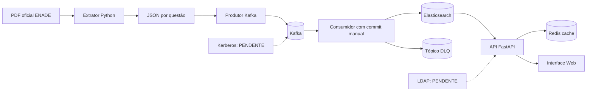

# Arquitetura — TP2 ENADE

> Status: **protótipo inicial**. O enunciado pede um acervo abrangente, Kerberos, LDAP,
> alta resiliência e evidências de desempenho. Isso NÃO está implementado só porque
> os serviços aparecem neste desenho.

## Contratos e limites

- `docs/SCHEMA.md` é a referência para o JSON e os endpoints.
- Topologia inicial: 1 broker Kafka KRaft, tópico autocriado, 1 nó
  Elasticsearch (1 shard + 0 réplicas) e 1 Redis. **Sem alta disponibilidade**.
- Persistência por volumes nomeados. Indexação idempotente via `_id`
  determinístico. Consumidor manualmente confirma offsets após sucesso.
- Garantia efetiva: *at-least-once* sob as condições do ambiente local;
  falhas de disco/host e perda do volume único não são cobertas.
- Fluxo de DLQ depende de confirmação da publicação e deve ser testado
  em simulações de falhas antes de afirmar 'zero perda'.
- Elastic e Kafka estão **sem autenticação** no laboratório. Não implantar
  esta configuração em servidor público.
- Estudante/professor e bloqueio 403 só serão considerados cumpridos após
  integração real com LDAP e testes da API (não apenas ocultar campos no front).
- Tratar Kerberos + Elasticsearch como risco de implementação/licenciamento.
- Métricas do relatório devem vir de testes reais, não de expectativas.
